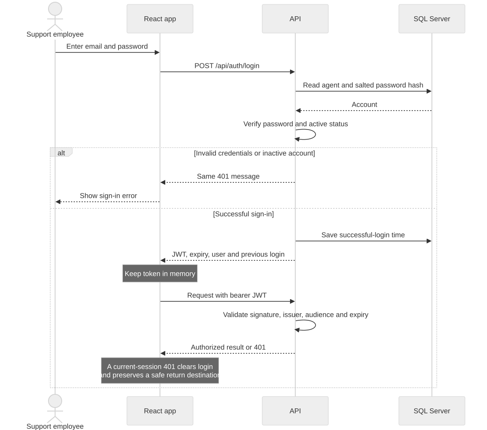

# Northwind Support Desk

.NET 10 API, React/TypeScript and SQL Server 2022. This implementation covers the four assessment tasks and previous-successful-login tracking. The optional SLA report is excluded. Design trade-offs and AI-use notes are in [APPROACH.md](APPROACH.md).

## Run

Prerequisites: Git, Docker Desktop with Linux containers, .NET 10 SDK, and Node 22.22.2+ or 24.15+. The locked test dependencies require these Node patch levels.

```powershell
# Copy only if .env does not already exist.
Copy-Item .env.example .env
npm ci
docker compose up --build
```

In another PowerShell terminal:

```powershell
$env:VITE_API_PROXY_TARGET = 'http://localhost:5080'
npm run web
```

Web: http://localhost:5173. API: http://localhost:5080. Development Swagger: http://localhost:5080/swagger. Anonymous `/health` checks the database. Development startup migrates and seeds 40 tickets, six agents, six customers and five categories. Restarting retains data and existing password hashes.

**Local login:** `alex.turner@northwind-support.example` / `LocalDemo-Only!2026`. Active seeded agents share this obvious development fixture password; inactive Yuki cannot sign in. Replace fixture passwords and signing keys outside Development.

For a host API, start only SQL with `docker compose up -d sqlserver`, run `dotnet tool restore`, set `$env:Jwt__SigningKey = 'LocalFixture-Only-Change-Before-Production-2026'`, then `npm run api`. Point Vite at `http://localhost:5043`. Compose's `.env` is not automatically exported into `dotnet run`.

## Decisions

**Task 1.** DEFECT-117 was an effect reading every filter but subscribing only to search/pagination, so status changes sent no request. The hook now observes the complete committed query, requests dropdown changes immediately, debounces only search for 300 ms, and ignores cancelled/obsolete responses. The actual-request regression failed before the fix: one fetch expected, zero received. Defect and backend filtering were committed separately.

`TicketQueries.ApplyFilters` applies exact matches, unassigned-only and trimmed search before SQL count/paging. Search is OR across title/reference/customer, AND with other filters. Reads are untracked, projected and ordered with an Id tie-break. The SLA CASE expression is shared by filtering/projection. Tests inspect relational SQL and verify live SQL Server results. Add a typed filter, serializer entry and predicate; no effect dependency change. Substring search can scan; no speculative index was added.

**Task 2.** Keep the supplied layered monolith: Domain policies hold SLA/assignment rules; Application handlers coordinate them; Infrastructure owns EF queries/transactions; Presentation owns HTTP. Shared policies, repository/unit-of-work writes and separate read projections fit this application. A mediator framework or event bus would add work without improving the required behaviour.

Priority defaults to Medium; category flags force Critical or require specialists. Configurable windows are Critical 4h, High 8h, Medium 24h, Low 72h; Premium multiplies by 0.5 with a 1h floor. Choose active eligible agents strictly below capacity, fewest open tickets, then lowest Id. Nobody eligible is a normal unassigned 201 with a reason. An existing owner at capacity is ineligible under the literal “strictly below” rule. Manual assignment retains the supplied explicit override behaviour.

Escalation raises one level, recomputes from now, rechecks ownership and appends immutable before/after history. Invalid reason is 400, unknown ticket 404, Critical/Resolved/Closed 409. A ticket version rejects stale updates. Serializable transactions protect workload reads through assignment/history commit; confirmed SQL deadlocks retry the whole decision with fresh tracked state. Uncertain commit failures are never automatically replayed. A database sequence allocates references across requests/processes, starts beyond existing/seeded references, and can leave harmless gaps after failures.

SLA status is derived with an injectable clock. Deadline/risk-boundary timestamps preserve the promised window after escalation/configuration changes. Historical missing boundaries use current settings. No due date means No SLA; resolved on/before due is Met; exactly due is At risk, one tick later Breached. Timestamps use datetime2(7). `TicketEscalations` has restricted foreign keys and `(TicketId, EscalatedAtUtc DESC, Id DESC)` for newest-first history; existing ticket indexes remain. Forward migrations preserve existing rows.

**Task 3.** One Agent is one account, so credential fields belong on Agent. Identity PasswordHasher supplies salted hashes. Unknown/wrong/inactive credentials have the same 401 response. JWTs last 30 minutes, with signature, algorithm, issuer, audience and expiry validation plus 15 seconds of clock skew. The signing key comes from runtime configuration. Central fallback authorization protects all endpoints; login/health are explicit exceptions and Swagger is open in Development. Escalation actors come from token subjects, never request bodies.



The client keeps the token in memory: refreshing requires sign-in, and persistent token storage is avoided. This does not eliminate XSS. Protected routes preserve safe internal destinations; logout/401 clears the session. Old requests cannot overwrite a newer session. Failed logins leave the saved login timestamp unchanged; successful logins use a bounded compare-and-swap. A frontend route guard improves navigation; API authorization enforces access.

**Task 4.** The root-context multistage Dockerfile restores project metadata before source, then publishes into a non-root ASP.NET image on 8080, mapped to localhost:5080. SDK, sources, EF design-time tooling, `.env` and Development settings are excluded. Runtime variables supply SQL/JWT/SLA configuration; see `.env.example`. Compose uses service DNS and waits for SQL health. Globalization is retained for SQL; trimming/AOT was rejected because EF/validation use reflection.

## Verify

```powershell
npm test
npm run build
npm run lint
npm run typecheck
npm run format:check
```

**Verified on 20 October 2026:** 65 backend + 5 architecture + 33 frontend tests pass (103 total, SQL Server enabled). Build, lint, type checks and formatting pass.

The default suite uses xUnit/Moq, FixedClock/TicketBuilder, relational SQLite, real HTTP/JWT middleware and Vitest/RTL. SQL Server concurrency/migration tests additionally require a server with permission to create temporary databases:

```powershell
$env:SUPPORTDESK_TEST_SQL = 'Server=127.0.0.1,1433;Database=master;User Id=sa;Password=Local_Dev_Password1;TrustServerCertificate=True;Encrypt=False'
npm test
```

Those five tests skip explicitly when the variable is absent. Each creates/drops only its own GUID-named database. SQLite HTTP tests substitute reference allocation because SQLite has no sequences; production allocation and locking are exercised on SQL Server. Coverage includes competing creates/escalations, one remaining capacity slot, legacy-reference migration, failed-history rollback, uncertain commits, SLA boundaries, filter requests, JWT rejection and UI/session response races.

Repeat live API checks with `pwsh -File scripts/verify-live.ps1`. The optional `node scripts/browser-live.mjs` requires Playwright/Chromium and Vite running. The latest live run passed 40 API checks and 8 browser checks. Reports go into ignored `artifacts/`; scripts create development tickets and affect workloads. Selected screenshots: [sign-in](assets/screenshots/sign-in.png), [detail/history](assets/screenshots/ticket-details.png), [mobile](assets/screenshots/ticket-details-mobile.png).

Docker checks cover fresh migration/seed, retained-data upgrades, source-edit restore caching, runtime size versus SDK, `whoami=app`, absence of SDK/secret files, Vite proxy and an isolated unreachable-database health check. The measured API image is 454,879,688 bytes (455 MB) versus the measured 1.304 GB SDK image; `/app` is 82 MB. Healthy DB returns 200; the isolated failure probe returned 503 in 5.35 seconds. These are measured development results, not a load benchmark.

## Limits and submission

Serializable workload reads trade throughput for correctness on this small desk; no 10-million-ticket benchmark is claimed. Manual assignment remains an override. SLA labels refresh on fetch. Issued JWTs remain valid until expiry after logout or later deactivation; `/me` checks activity. Refresh tokens, MFA, registration, rate limiting, roles, bot detection and deployment infrastructure are outside the brief. Passwords are hashed, not reversibly encrypted; JWT claims contain no credentials.

In production, use reviewed migration scripts/bundles as a controlled deployment step, disable demo seeding, use a less privileged runtime database account and replace fixtures. Submission includes the fork link, development credentials and actual time spent per task. The review PR is optional; the brief requires the fork.

Codex assisted code, tests, debugging and documentation. Standard Identity hashing was retained after verification; per-filter effect wiring was rejected. Review changed duplicated SLA logic, entity responses and table naming. An AI-generated health extension call initially failed compilation and was corrected. Concurrency and stale-response regressions failed before their fixes. Builds, real database/API tests and browser inspection checked generated work; not every earlier change followed TDD.
